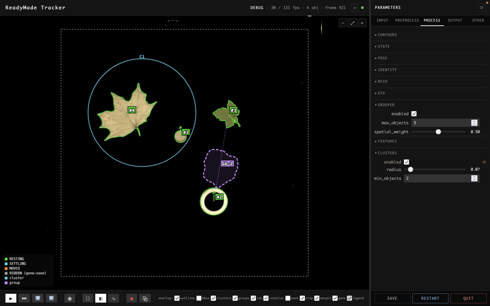
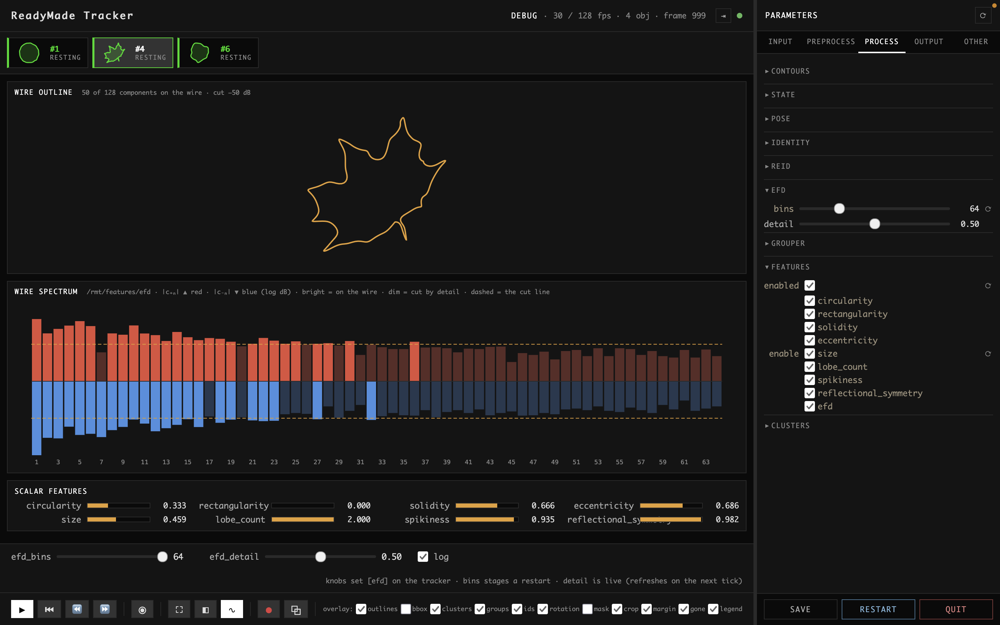

# TheReadymadeTracker

The Readymade Tracker is an open-source toolkit for tangible tabletop interaction with
unmodified everyday objects. It follows unmarked objects under a single overhead camera,
without markers, learned models or a GPU, and publishes their position, rotation, outline and
shape features over OSC and TUIO 2.0 once they have come to rest. The engine is written in
Python 3 and depends on NumPy and OpenCV 5 only.

It accompanies the paper *Readymade Tangible Interaction: A Framework for Exploring Everyday
Objects As Tangibles* by Antoni Rayzhekov and Martin Murer (TEI 2027).

While objects are being moved the tracker **holds the last settled state** (outputs keep
emitting the frozen registry); when a region goes quiet it re-scans **only that region** and
updates the objects there. Two people manipulating objects far apart never block each other —
whoever settles first updates first (**partial update**). A manual `/rmt/trigger` (OSC, webgui
button, or `[mcu]` foot pedal) forces a rescan.

- **Inputs:** video files or a UVC camera (with a chessboard calibration tool).
- **Outputs:** TUIO 2.0, a generic OSC egress (the tracker's own protocol), MJPEG-over-HTTP,
  and an mp4 recorder.
- **Control:** a dependency-free browser control surface (webgui) + OSC control input + an
  optional serial panel (`[mcu]`: a footswitch sends `T` to rescan, a knob sends `D <0..1>` for
  EFD detail) — all three drive the same verbs and the same live-parameter store. The panel
  auto-builds from each stage's declared parameters. No OS/desktop window.
- **Optional re-identification:** a classical (neural-free) appearance tie-break, enabled when
  `[reid]` is present in the config; otherwise identity falls back to shape + position. It is a
  21-d saturation+shape+size descriptor computed with the OpenCV already installed — no model
  file, no extra dependency.

## Run

```sh
python3 -m venv venv && ./venv/bin/pip install -r requirements.txt
./venv/bin/python readymade_tracker.py --source video tests/videos/hands2.mp4 --pull
```

Then open the webgui at `http://localhost:8090/`. Ports: webgui 8090 / mjpeg 8080 / oscin 3401.

With a live camera on **macOS**, start it with `sudo`, since locking exposure, gain and white
balance over UVC needs permission to claim the device (see [`INSTALL.txt`](INSTALL.txt)):

```sh
./venv/bin/pip install pupil-labs-uvc
sudo ./venv/bin/python readymade_tracker.py --source camera camera1.conf
```

`camera1.conf` is written by the calibration tool (`tools/calibrate_camera_web.py`).

## Screenshots

The browser control surface, debug view: settled objects with ids and rotation, a cluster
(`C1`) and a fused group (`G6·2`), with the live parameters on the right.



The features view: the EFD outline as sent on the wire, its spectrum, and the scalar shape
features of the selected object.



## Benchmarks

The distribution carries the benchmark of the paper *Readymade Tangible Interaction: A
Framework for Exploring Everyday Objects As Tangibles*: one raw 1920×1080 recording is both the
performance workload (the full preprocess chain, paced at real time, with a real OSC/TUIO
client receiving both output streams) and the correctness check (scored against a hand-made
MOT ground truth). Two commands per machine:

```sh
./venv/bin/python benchmarks/run.py --name <machine>
./venv/bin/python benchmarks/analyze.py
```

See [`benchmarks/README.txt`](benchmarks/README.txt) for the procedure and the pass criterion.

## Folder structure

```
readymade_tracker.py    the orchestrator (parse conf → build → serve); __version__ lives here
readymade.conf          the configuration (INI; a [section] present = that plugin enabled)
benchmark.conf          the benchmark's PERFORMANCE configuration (full preprocess chain)
benchmark_gt.conf       the benchmark's VALIDATION configuration (the annotated view)
requirements.txt        numpy + opencv-contrib-python — the WHOLE runtime
lib/                    the core: scene registry, pipeline stages (observe/classify/identity/
                        pose), EFD subsystem, features, clusters, grouper, params, preprocess
plugins/
  input/                video file · UVC camera backends
  control/              control INPUTS: oscin (OSC) · webgui (browser surface) · mcu (serial)
  output/               tuio2 · oscout (the tracker's own OSC) · mjpeg · rec (mp4 recorder)
tools/                  tuio2_monitor.py (the wire inspector) · calibrate_camera.py (dearpygui) ·
                        calibrate_camera_web.py (the same calibration in the browser, no extra dep)
benchmarks/             the benchmark suite: run.py / analyze.py + calibration + results
tests/                  the pytest suite (pip install pytest; venv/bin/python -m pytest tests)
tests/videos/           the benchmark clips and their MOT ground truth
docs/                   CONFIGURATION · OSC_COMMAND_PROTOCOL · OSC_OUT_PROTOCOL · TUIO2_PROTOCOL ·
                        TOOLS
examples/               SuperCollider / PureData / vvvv clients for the OSC and TUIO streams
```

(The development repository additionally carries archived design documents and research
tooling; this repository is the running system, its test suite, and everything needed to
reproduce the paper's measurements.)

The OSC formats are [`docs/OSC_COMMAND_PROTOCOL.txt`](docs/OSC_COMMAND_PROTOCOL.txt) (control in) and
[`docs/OSC_OUT_PROTOCOL.txt`](docs/OSC_OUT_PROTOCOL.txt) (the tracker's own data out); the
standard-protocol stream is [`docs/TUIO2_PROTOCOL.txt`](docs/TUIO2_PROTOCOL.txt) — two
surfaces at different layers, not a complete one and a partial one. Every configuration knob
is catalogued in [`docs/CONFIGURATION.md`](docs/CONFIGURATION.md).

## Version

The tracker prints its version number when it starts, for example `ReadyMade Tracker v0.32.168`.
The number reads `MAJOR.MINOR.BUILD`, where BUILD increases with every small change and MINOR
with every larger one. It is defined in one place, as `__version__` in `readymade_tracker.py`.

## License

MIT — see [`LICENSE`](LICENSE).
